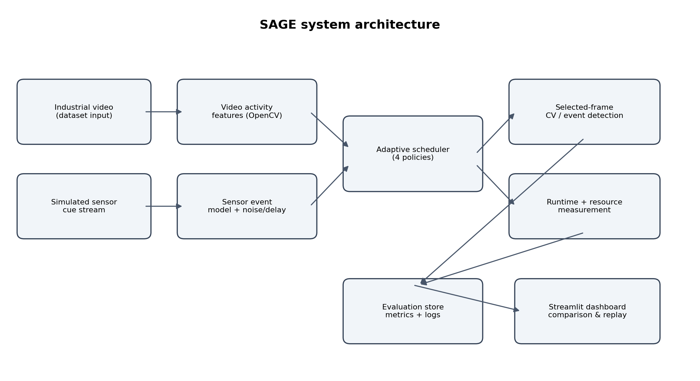
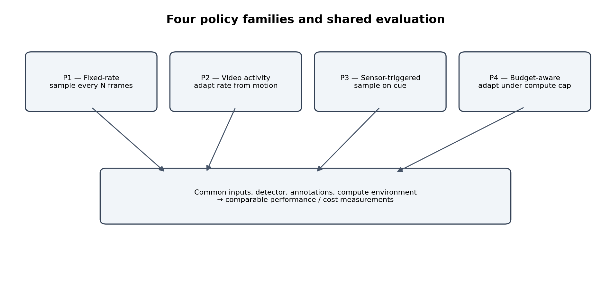
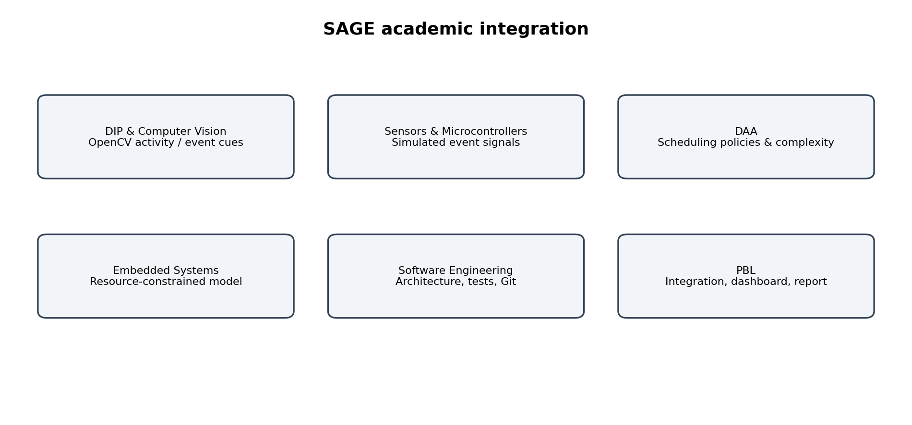

# SAGE
## Sensor-Guided Adaptive Video Processing for Resource-Constrained Industrial Monitoring

**Technical Project Definition and Research Plan**  
**Version:** 1.1 — Consolidated baseline  
**Status:** Scope baseline; dataset and experimental protocol remain subject to validation  
**Audience:** Academic evaluators, project team, and technical/industry reviewers

---

## Document control

| Field | Value |
|---|---|
| Project | SAGE |
| Project type | Applied research and software prototype |
| Domain | Industrial production-line monitoring |
| Current-semester implementation | Simulation-first, software-only |
| Team | 3 members |
| Primary interface | Interactive Streamlit dashboard |
| Core stack | Python, OpenCV, Streamlit; supporting libraries selected during implementation |
| Physical implementation | Deferred to a subsequent semester |
| Cloud dependency | Not required |

### Revision note
This document consolidates the current project baseline with relevant material from prior SAGE feasibility, research-problem, and industrial-monitoring documents. Where earlier alternatives conflict with the current baseline, the current baseline takes precedence. Dataset suitability, exact event taxonomy, sensor-cue generation, and the final experimental protocol remain open until validated. SAGE originated as a physical active-vision concept (a camera moved between monitored zones); it was redirected to sensor-guided adaptive video processing to remove mechanical dependencies while keeping the allocation of limited observation and computation as its core idea. Version 1.1 adds material carried over from the former Research Proposal, Literature Review and Reading Map, and Project Brief and Defense Guide (see Appendices B–D).

---

## Executive summary

SAGE investigates whether **sensor-guided adaptive video processing** can reduce computational work in industrial monitoring while preserving acceptable event-detection performance. The project focuses on a production-line/conveyor monitoring scenario in which continuous high-rate video analysis may be unnecessarily expensive during stable operation.

The proposed software framework combines real, publicly available industrial video with simulated sensor-event cues. A scheduler selects when video frames should be processed. Four policy families will be implemented and compared under matched inputs and experimental conditions: fixed-rate sampling, video-activity-adaptive sampling, sensor-triggered sampling, and budget-aware adaptive sampling. OpenCV-based processing will provide the video activity and event-detection components; a Streamlit dashboard will expose configuration, playback/review, and comparative measurements.

The primary contribution is an implemented and reproducibly evaluated adaptive-processing framework—not a claim of a new anomaly detector or a validated industrial safety system. The experiment will measure computational cost and detection outcomes together. The project will explicitly account for cue delay, noise, missed triggers, and false triggers so simulated sensor signals do not unrealistically provide advance knowledge of anomalies.

A physical sensor/camera/edge-device implementation is planned as future work. No physical prototype is included in the current-semester scope.

---

## 1. Project definition

### 1.1 Problem context
Industrial monitoring systems may continuously process video even when the scene is stable. This can impose avoidable CPU/GPU work, energy use, and latency pressure on resource-constrained deployments. A sampling policy that reduces processing frequency may lower computational cost, but can also miss short-lived events or detect them later.

SAGE studies this trade-off in an industrial video-monitoring setting using a controlled software experiment.

### 1.2 Problem statement
**How can sensor-event cues and visual activity information be used to adapt video-processing frequency in industrial monitoring, and what computational savings can be achieved without unacceptable degradation in event-detection performance?**

### 1.3 Research question
Under identical industrial video inputs, event definitions, detector settings, and experimental conditions, how do four sampling policies compare in:
- computational work and processing rate;
- event-detection precision/recall or other suitable detection metrics;
- event detection delay;
- missed-event rate;
- robustness to sensor cue noise, delay, false triggers, and missed triggers?
### Working hypotheses

- **H1** — When cues are timely and reliable, at least one sensor-guided policy will improve the event-recall versus processing-cost trade-off over fixed-rate sampling on the selected footage.
- **H2** — Increasing cue misses, false-trigger rate, or delay will reduce or eliminate any advantage of sensor-guided policies.
- **H3** — Video-activity-adaptive sampling may match or outperform sensor guidance in some conditions; that is a valid result.

These are hypotheses to be tested, not expected results. A negative or inconclusive outcome is reportable if the methodology is sound.

### 1.4 Primary objective
Build a functioning, reproducible software system and experimentally determine whether sensor-guided adaptive processing reduces computational overhead while maintaining acceptable event-detection performance.

### 1.5 Supporting objectives
1. Validate an accessible industrial video dataset and its temporal annotations.
2. Define a bounded event taxonomy and region of interest (ROI).
3. Implement video activity features using classical OpenCV methods.
4. Implement a configurable sensor-cue simulator with realistic imperfections.
5. Implement and compare four scheduling policies.
6. Record runtime, frame-processing counts, detection results, and event latency.
7. Present configurations and results through an interactive dashboard.
8. Produce reproducible experiment artifacts, a technical report, and an IEEE-structured research manuscript.

---

## 2. Scope and boundaries

### 2.1 In scope
- Industrial production-line/conveyor monitoring.
- Real publicly available video footage.
- Software-based processing and simulated sensor events.
- OpenCV-based image processing and activity estimation.
- Four comparable sampling/scheduling policies.
- Controlled experiments with repeatable configurations.
- Streamlit dashboard for experiment setup, result inspection, and comparisons.
- Software testing, modular architecture, version control, and documentation.
- Resource-constrained performance modeling and discussion of future edge deployment.

### 2.2 Out of scope for this semester
- Physical prototype or live sensor installation.
- Direct integration with a production line or operational factory.
- Safety-critical alarms, machine control, or autonomous shutdown.
- Claims of industrial certification or production readiness.
- Cloud infrastructure as a required dependency.
- Training a large custom deep-learning model from scratch.
- Broad multi-industry coverage beyond the selected video scenario.
- Claims that simulated sensor cues represent measured hardware performance.

### 2.3 Future work
A subsequent semester may integrate a Raspberry Pi, Arduino, camera, and physical sensors; measure actual device-level resource consumption; and evaluate the framework under live sensor timing and deployment constraints.

---

## 3. System concept

SAGE is organized around a video stream, a simulated sensor-cue stream, a scheduling policy, a common processing/detection path, and an evaluation/dashboard layer.

**Figure 1.** Proposed system architecture. The implementation should preserve a common detector and measurement path across policies so comparisons are attributable to scheduling differences.

### 3.1 Main components
| Component | Responsibility |
|---|---|
| Video dataset adapter | Load footage, timestamps/frame indices, splits, and annotations |
| Video activity estimator | Estimate motion/activity using OpenCV features |
| Sensor-cue simulator | Generate event cues with configurable timing and imperfections |
| Policy scheduler | Decide whether/when to process frames |
| CV processing pipeline | Process selected frames and produce event/anomaly outputs |
| Measurement logger | Record processed frames, runtime, detections, delays, and configuration |
| Experiment runner | Repeat policies across matched videos and conditions |
| Streamlit dashboard | Configure runs and inspect results |
| Results store | Persist experiment metadata and outputs for reproducibility |

### 3.2 Data flow
1. Load validated video and annotation metadata.
2. Compute or load visual activity features.
3. Generate simulated sensor cues using an explicit cue-generation model.
4. Apply one policy to decide which frames are processed.
5. Run the same CV pipeline on selected frames.
6. log processing cost and detection outcomes.
7. Repeat under matched conditions for all policies.
8. Aggregate metrics and display comparisons.

---

## 4. Scheduling policies

All policies must use the same video input, event annotations, CV detector, processing resolution, hardware/software environment, and evaluation rules. Policy-specific parameters must be documented and tuned without using test outcomes to unfairly favor one policy.

### P1 — Fixed-rate sampling
Process frames at a fixed interval, independent of activity or sensor cues. This is the baseline against which adaptive policies are compared.

### P2 — Video-activity-adaptive sampling
Adjust sampling frequency based on visual activity estimates. Stable scenes use a lower sampling rate; higher activity causes more frequent processing. The activity threshold and rate bounds must be fixed through a documented calibration procedure.

### P3 — Sensor-triggered sampling
Use simulated sensor-event cues to increase or initiate video processing. The cue stream must reflect plausible sensor availability and must not encode anomaly ground truth in advance. Cue timing should include configurable delay, noise, false triggers, and missed triggers.

### P4 — Budget-aware adaptive sampling
Adapt sampling decisions while respecting a defined computational budget or target processing rate. The policy may combine activity and sensor cues, but its decision logic and budget enforcement must be explicit and reproducible.

**Figure 2.** Policy families. All are evaluated through a common processing and measurement path.

### 4.1 Fair-comparison requirements
- Identical source videos and evaluation intervals.
- Same detector and detector parameters.
- Same ROI and preprocessing.
- Same machine and software configuration where practical.
- Same event annotations and metric definitions.
- Report warm-up, excluded intervals, and failed runs.
- Separate calibration videos/segments from evaluation segments.
- Report per-video results as well as aggregate results.
- Preserve run configuration and raw logs.

### 4.2 Scheduling complexity

For a video of F frames, fixed-rate sampling with interval k processes approximately F/k frames. Adaptive policies add a scheduling cost per sampling decision; sensor-triggered sampling also adds cue-handling cost that grows with the number of cue events; budget-aware scheduling adds its budget-accounting and update cost. The analysis must keep **algorithmic scheduling complexity** separate from the **image-processing cost** of the selected frames. These are different quantities and are measured separately (see Policy overhead in §8.2).

---

## 5. Dataset strategy and validation

### 5.1 Candidate A — IPAD
The IPAD Industrial Process Anomaly Detection dataset is the leading candidate because it is designed for industrial video anomaly detection and includes conveyor-related scenarios, periodicity information, and frame-level anomaly annotations. Public dataset-card material describes 16 industrial device scenarios, including synthetic and real-world settings, and approximately 597,979 frames. These figures and the exact available formats must be checked against the original project source and downloaded release before being treated as final project facts.

**Links**
- Project page: https://ljf1113.github.io/IPAD_VAD
- Paper: https://arxiv.org/abs/2404.15033
- Dataset mirror: https://huggingface.co/datasets/MSherbinii/ipad-industrial-anomaly

**Validation risks:** the accessible release may be frame-oriented rather than directly usable continuous video; exact timing/frame-rate metadata, licensing, temporal boundaries, and sensor-cue plausibility must be checked. If frames are reconstructed into sequences, the reconstruction must preserve original ordering and timestamps where available.

### 5.2 Candidate B — iron-ore conveyor foreign-object dataset
A Mendeley Data dataset published in 2025 contains high-speed recordings and extracted frames from a laboratory-scale conveyor carrying iron ore, with manually introduced foreign objects. The repository describes raw MP4 video and derived labeled subsets. The dataset is directly relevant to conveyor monitoring, but the temporal annotations and event boundaries need inspection before it can support sampling-policy evaluation.

**Links**
- Mendeley Data record: https://data.mendeley.com/datasets/s25x2bnshz/1
- Dataset article: https://doi.org/10.1016/j.dib.2025.111537

### 5.3 Candidate C — MVTec AD (not primary)
MVTec AD is an industrial anomaly benchmark consisting of still images with pixel-level anomaly annotations. It may support ancillary image-based CV experiments, but it is not suitable as the primary dataset for temporal sampling-policy evaluation because it does not provide continuous video sequences.

**Link:** https://www.mvtec.com/research-teaching/datasets/mvtec-ad

### 5.4 Dataset selection gate
The dataset is not considered selected until the team verifies:
- download availability and file integrity;
- permitted use and attribution/license terms;
- continuous video availability or defensible temporal reconstruction;
- frame rate, timestamps, and ordering;
- event/anomaly annotations and temporal boundaries;
- sufficient normal and anomalous intervals;
- compatibility with the chosen classical CV detector;
- whether event cues can be simulated without oracle-like access to labels;
- reproducible train/calibration/test partitioning.

**Selection rule:** choose the dataset that best supports a valid temporal experiment, not merely the dataset with the largest number of images or anomaly categories.

### 5.5 Candidate event categories (provisional)

- Conveyor stoppages.
- Unexpected gaps in material flow.
- Accumulation of products.
- Production activity falling below an expected level.
- An object failing to appear at an expected monitoring station.

These are candidate categories, not a finalized event taxonomy. One or two categories will be selected according to what the validated dataset shows and annotates reliably, and each will be defined precisely before annotation or evaluation (see §14, Event taxonomy).

### 5.6 Data rights and handling

- Use a dataset only when its license or terms permit academic research; check separately whether it may be stored in the repository, shown in demonstrations, and reproduced in the manuscript or presentations.
- If footage shows identifiable people, do not use face recognition or store face images; blur or exclude such frames where publication requires it.
- Limit raw-video retention and access; keep event timestamps, manifests, and aggregate results where possible.
- Record source, version, license, transformations, and retention decisions for each dataset.

---

## 6. Sensor-event simulation

Sensor inputs are simulated for this semester. They represent plausible event cues from proximity, photoelectric, or motion sensors; they are not measurements from physical hardware.

### 6.1 Required cue model
For each event or cue source, define:
- cue generation rule;
- nominal event-to-cue delay;
- timing jitter;
- missed-trigger probability;
- false-trigger probability;
- cue persistence/debounce behavior;
- sensor sampling frequency;
- any assumed sensor placement or field of view.

### 6.2 Anti-oracle requirement
The simulator must not use future anomaly labels to trigger processing before an event would realistically be observable. A cue may be aligned to an observable event onset or a physically plausible precursor only if the precursor is explicitly justified and available in the source data. Where no realistic cue can be inferred, use a controlled synthetic cue schedule and label the assumption clearly.

### 6.3 Robustness experiments
At minimum, evaluate:
- nominal cue quality;
- increased cue delay;
- missed triggers;
- false triggers;
- noisy or jittered timing.

The specific parameter values should be selected and documented during protocol design. They must not be presented as measured sensor characteristics.

---

## 7. Computer vision approach

### 7.1 Semester-one approach
Use classical OpenCV methods and, if justified by dataset format and scope, a pretrained model for a bounded detection task. The baseline should remain interpretable and computationally measurable.

Potential components, subject to validation:
- frame differencing or background subtraction for activity;
- ROI masking for the monitored conveyor/production region;
- motion/activity score calculation;
- threshold-based event candidate generation;
- optional pretrained object detector for a specific visible event class.
A classical pipeline would typically include, subject to validation:

- frame acquisition at the indices selected by the policy;
- resizing and grayscale conversion;
- Gaussian filtering;
- frame differencing or background subtraction;
- thresholding and morphological operations;
- motion-region extraction within the ROI.

Where time permits, at least two activity-estimation methods (for example, frame differencing and background subtraction) should be compared, because they differ in computational and detection characteristics.

### 7.2 Detector selection criteria
- visible in selected footage;
- compatible with available annotations;
- computationally tractable;
- reproducible with fixed model/version;
- does not dominate the scheduling comparison to the point that policy differences become unmeasurable;
- allows event detection delay to be measured.

The project must distinguish **sampling-policy evaluation** from **detector accuracy evaluation**. The same detector is used across policies; the detector is not claimed as a novel contribution.

---

## 8. Evaluation methodology

### 8.1 Experimental design
Use paired comparisons: every policy processes the same videos under the same condition set. Repeat runs where runtime variability is material. Record environment details and preserve raw per-run logs.

### 8.2 Primary measurements
| Metric | Definition / purpose |
|---|---|
| Processed-frame ratio | Processed frames divided by total available frames |
| Processing-time reduction | Relative change in measured processing time vs. fixed-rate baseline |
| CPU utilization / memory | Resource measurements where reliable tooling is available |
| Event recall | Fraction of annotated events detected |
| Event precision | Fraction of detections matching valid events |
| Detection delay | Time from annotated event onset to first valid detection |
| Missed-event rate | Fraction of events not detected within the evaluation window |
| False alarms | Unmatched detections per unit time or video |
| Throughput | Frames or video-time processed per wall-clock second |
| Policy overhead | Additional scheduler/cue-processing cost |

### 8.3 Reporting
Report both computational savings and detection quality. A policy is not considered successful merely because it processes fewer frames. Results should include:
- per-video and aggregate values;
- variability or confidence intervals where appropriate (for example, paired bootstrap intervals if practical);
- event-level error analysis;
- sensitivity to cue imperfections;
- limitations arising from dataset scale and simulation assumptions.

### 8.4 Reproducibility artifacts
- dataset version and source URL;
- dataset selection/validation notes;
- code commit and dependency versions;
- policy parameters;
- sensor simulation parameters;
- detector/model version;
- video and annotation identifiers;
- run logs and random seeds;
- metric calculation scripts;
- dashboard screenshots or exported result tables.

### 8.5 Research manuscript

An IEEE-structured research manuscript is a required deliverable. It reports the actual methodology and measured results; submission suitability and acceptance are not assumed. Planned structure:

- Abstract
- Introduction and problem statement
- Related work
- System model and problem formulation
- Scheduling algorithms
- Experimental methodology
- Results and comparative analysis
- Threats to validity and limitations
- Conclusion and future work
- References

---

## 9. Dashboard specification

The Streamlit dashboard is an experimental interface, not a production monitoring console.

### Core views
1. **Dataset & configuration:** selected video, ROI, policy, parameters, cue settings.
2. **Run control:** execute a policy or a matched comparison set.
3. **Video review:** original footage, selected-frame markers, event annotations, detections.
4. **Policy comparison:** processed-frame ratio, runtime, detection metrics, delay, false alarms.
5. **Robustness analysis:** performance under cue delay/noise/missed/false triggers.
6. **Export:** configuration, CSV/JSON logs, figures, and summary tables.

### Dashboard constraints
- show which values are measured, derived, or simulated;
- do not display unexecuted or placeholder results as real measurements;
- make the policy configuration visible;
- provide a way to reproduce a run from its stored configuration.

---

## 10. Software engineering and implementation principles

- Modular components with explicit interfaces.
- Configuration-driven policy parameters.
- Deterministic runs where possible.
- Unit tests for scheduler decisions, cue simulation, metric calculations, and data parsing.
- Integration tests for end-to-end runs.
- Smoke test for dashboard startup and a small sample experiment.
- Git-based version control and issue tracking.
- Clear separation of source code, data manifests, experiment outputs, and reports.
- Do not commit large datasets or generated artifacts unless repository policy permits.
- Record known limitations and failed experiments.

---

## 11. Academic subject mapping

**Figure 3.** How SAGE provides evidence for the six course areas.

| Subject | Project contribution | Evidence/deliverable |
|---|---|---|
| Design and Analysis of Algorithms (DAA) | Scheduling policies, complexity, comparative analysis | Policy pseudocode, complexity discussion, benchmark results |
| Sensors & Microcontrollers | Sensor-event semantics and simulated cue imperfections | Cue model, timing/noise experiments, sensor interface specification |
| Digital Image Processing & Computer Vision | OpenCV activity estimation and selected-frame event processing | CV pipeline, ROI/method justification, detector evaluation |
| Software Engineering | Requirements, architecture, modularity, testing, version control | SRS, architecture/design artifacts, tests, repository |
| Embedded Systems | Resource-constrained processing model and scheduling | Resource metrics, budget-aware policy, edge-deployment discussion |
| Project Based Learning (PBL) | Integrated prototype and research-oriented evaluation | Working dashboard, demo, final report, presentation |

---

## 12. Risks, assumptions, and mitigations

| Risk / assumption | Consequence | Mitigation |
|---|---|---|
| Dataset is frame-only or lacks reliable timing | Temporal sampling experiment may be invalid | Inspect source formats and metadata before selection |
| Event annotations are coarse | Detection delay/recall may be unreliable | Define event matching rules; report annotation limits |
| Simulated cues are unrealistically informative | Overstates sensor-guided benefit | Use observable timing, delay/noise, and anti-oracle checks |
| CV detector is too expensive | Scheduler savings may be obscured | Measure scheduler and detector costs separately |
| Different policies receive unequal tuning | Biased comparison | Use calibration split and common evaluation protocol |
| Short footage or few events | Weak statistical conclusions | Report per-video results and limitations; avoid overclaiming |
| Dashboard work displaces experiments | Incomplete evidence | Prioritize reproducible runner and metrics before UI polish |
| Future hardware assumptions are treated as measured | Misleading deployment claims | Clearly separate simulation from future physical validation |

---

## 13. Research contribution and claim boundaries

### Defensible contribution
A software framework and controlled comparative evaluation of four adaptive video-sampling policies, incorporating simulated sensor cues with explicit imperfections, and reporting the trade-off between computational work and event-detection performance in an industrial video scenario.
### Evidence and supported claims

| Evidence collected | Claims it can support | Claims it cannot support on its own |
|---|---|---|
| Real video with simulated sensor cues | Controlled comparison of scheduling policies under the stated simulation conditions | Reliability of physical sensors in deployment |
| Software timing on the named test machine | Relative processing cost on that machine under the tested conditions | Performance on a Raspberry Pi or other edge devices |
| Later-stage tests with physical sensors and camera | Behavior of the integrated setup under the tested physical conditions | Universal reliability or performance in all environments |

### Claims not supported at project start
- “SAGE is novel” without a completed literature comparison.
- “SAGE is real-time” without measured latency and throughput.
- “SAGE is energy-efficient” without energy measurement or a justified proxy.
- “SAGE is production-ready” or safety-certified.
- “Sensor guidance improves detection” before controlled results.
- “The framework generalizes to all industrial processes” from a narrow dataset.
- Any numerical performance improvement before experiments are run.
- Financial savings, return on investment, or productivity gains without measured resource savings and cost inputs.

### Literature positioning tasks
Before finalizing the paper, review:
- industrial video anomaly detection and IPAD;
- adaptive frame sampling and event-triggered video processing;
- sensor-assisted visual monitoring;
- resource-aware edge video analytics;
- evaluation methodology for event detection under sparse sampling.

The literature review should identify the closest comparable methods and state the contribution narrowly.

---

## 14. Current decision register

| Area | Current baseline | Status |
|---|---|---|
| Application | Industrial production-line monitoring | Frozen |
| Video input | Public industrial footage | Frozen |
| Dataset | IPAD leading candidate; conveyor dataset alternative | Open pending validation |
| Sensor input | Simulated proximity/photoelectric or motion cues | Frozen at concept level |
| CV | OpenCV-based image processing | Frozen at approach level |
| Scheduling | Four policy families | Frozen |
| Dashboard | Streamlit | Frozen |
| Semester implementation | Simulation-first; no physical prototype | Frozen — simulation confirmed acceptable for assessment |
| Research style | Applied research with reproducible experiments | Frozen |
| Cloud | Not required | Frozen |
| Research manuscript | IEEE-structured manuscript reporting actual results | Required |
| Future hardware | Raspberry Pi, Arduino, camera, physical sensors | Future work |
| Event taxonomy | Dataset-dependent | Open |
| Sensor cue model | Requires explicit realism assumptions | Open |
| Exact metrics/thresholds | Protocol design pending | Open |
| Literature gap | Requires systematic review | Open |

---

## 15. Immediate technical gates

1. Download and inspect the IPAD candidate and the conveyor dataset.
2. Verify video continuity, timestamps, annotations, license, and usable event intervals.
3. Select one dataset and one bounded industrial scenario.
4. Define event taxonomy, ROI, and event-matching rules.
5. Specify a sensor-cue model that avoids oracle-like triggering.
6. Freeze the experimental protocol and calibration/evaluation split.
7. Implement the fixed-rate baseline and common measurement pipeline first.
8. Add adaptive policies one at a time and verify matched comparisons.
9. Build dashboard views around actual experiment outputs.
10. Produce results only after reproducible runs are complete.

---

## Appendix A — Source and dataset references

1. Liu, J. et al. **IPAD: Industrial Process Anomaly Detection Dataset.** ACM Multimedia 2024 / arXiv:2404.15033. https://arxiv.org/abs/2404.15033
2. IPAD project page. https://ljf1113.github.io/IPAD_VAD
3. IPAD dataset mirror and dataset card. https://huggingface.co/datasets/MSherbinii/ipad-industrial-anomaly
4. Martins Sousa, F. et al. **Image dataset for foreign object detection in iron ore conveyor belt systems.** *Data in Brief*, 60 (2025), 111537. https://doi.org/10.1016/j.dib.2025.111537
5. Mendeley Data. **In-lab Image Dataset of Foreign Objects and Anomalies in Iron Ore Conveyor Belts**, V1 (2025). https://data.mendeley.com/datasets/s25x2bnshz/1
6. MVTec. **MVTec AD — Industrial Anomaly Detection Dataset.** https://www.mvtec.com/research-teaching/datasets/mvtec-ad

**Source verification note:** Public dataset pages and papers establish the candidate datasets’ stated descriptions. They do not establish that the team has downloaded, validated, or selected a dataset. Dataset license and exact temporal usability must be checked from the selected release before implementation and publication.

## Appendix B — Consolidated prior-document material

This report incorporates and updates relevant content from:
- *SAGE Project Feasibility and Scope*;
- *SAGE Research Problem and Project Direction*;
- *SAGE Industrial Production-Line Monitoring*;
- *SAGE Research Problem and Professor Review*.
- *SAGE Research Proposal* (26 Oct 2026) — hypotheses, data handling, and analysis detail;
- *SAGE Literature Review and Reading Map* (26 Oct 2026) — carried over as Appendix C;
- *SAGE Project Brief and Defense Guide* (26 Oct 2026) — review answers carried over as Appendix D.

Earlier alternatives are retained only where they remain relevant as open questions or future work. The current industrial, simulation-first baseline supersedes older exploratory options.

## Appendix C — Literature reading map

Carried over from the former *SAGE Literature Review and Reading Map* (26 Oct 2026). This is a structured starting map, not a completed systematic review. Resource-aware and adaptive video analytics already exist, so SAGE should make a bounded empirical contribution and avoid a first-of-its-kind claim unless a documented search supports it.

| Source | Contribution | Relevance to SAGE | Verify in full text |
|---|---|---|---|
| [1] Xu et al. 2023 | Survey of edge video analytics applications, architectures, techniques, datasets, and challenges. | Field context and search terms. | Coverage date; adaptation taxonomy; datasets and measures. |
| [2] Kang et al. 2017 | NoScope optimizes video queries using specialized models and cascades. | Shows cost reduction has prior art beyond frame skipping. | Task assumptions; per-video specialization; accuracy and hardware. |
| [3] Hung et al. 2018 | VideoEdge selects plans and placements under accuracy and resource constraints. | Motivates explicit budgets and cost-quality comparisons. | Formulation; baselines; deployment setting. |
| [4] Xiao et al. 2021 | Yoda studies performance variation across videos and time. | Supports paired tests, multiple clips, and reporting spread. | Benchmark design; features; metrics; limits. |
| [5] Qian et al. 2023 | OsmoticGate studies adaptive edge-based video analytics. | Shows adaptation itself is not a novel claim. | Adaptation variables; assumptions; baselines. |
| [6] OpenCV tutorial | Documents background-subtraction methods for foreground motion masks. | Supports a practical, interpretable prototype detector. | Lighting, shadows, camera motion, threshold limits. |

### Synthesis

Prior work establishes that video analysis has a resource-quality trade-off and that multiple system layers can be adapted [1]–[5]. Performance varies by workload and video, so a single favorable clip cannot justify a broad claim [4]. SAGE should hold video and detector constant while changing policy and cue quality. Whether the resulting contribution is sufficiently original remains open until a more systematic search is complete.

### Further leads (unverified)

- Vaisenberg et al. (2009), work on active camera observation scheduling — full bibliographic details still to be identified.
- *Adaptive Frame Sampling for Real-Time Video Object Detection and Multi-Object Tracking on Edge Devices*, reported as published online in June 2026 — https://gr-journals.com/journals/ictasa/issues/v2i2/26310
- IEEE Xplore record noted as OsmoticGate/SplitStream-related work on adaptive edge video analytics — https://ieeexplore.ieee.org/abstract/document/9839465/ (attribution to verify).

### Search and appraisal plan

- Search IEEE Xplore, ACM Digital Library, proceedings pages, and Google Scholar for edge video analytics, adaptive frame sampling, event-triggered video, sensor-guided video analytics, resource-aware observation scheduling, and industrial video anomaly detection.
- Use backward and forward citation chasing from [1]–[5]. Check venue, peer-review status, and the exact task for newer papers.
- For every paper, record objective, inputs, adaptation decision, hardware, dataset, baselines, metrics, findings, and limitations.
- Separate direct evidence from interpretation; do not infer a research gap from a title difference.
- Ask the supervisor to review the gap statement before manuscript submission.

### Questions for the reading group

- Which work changes frame selection, and which changes models, placement, or resource allocation?
- How do prior systems define event accuracy and latency?
- Do any papers compare noisy or delayed cues against video-only adaptation?
- What clip diversity supports the intended claim?
- Which metric exposes a policy that saves compute by missing short events?

### Literature references

[1] R. Xu, S. N. Razavi, and R. Zheng, “Edge Video Analytics: A Survey on Applications, Systems and Enabling Techniques,” IEEE Communications Surveys & Tutorials, vol. 25, pp. 2951–2982, 2023, doi: 10.1109/COMST.2023.3323091.

[2] D. Kang, J. Emmons, F. Abuzaid, P. Bailis, and M. Zaharia, “NoScope: Optimizing Neural Network Queries over Video at Scale,” Proceedings of the VLDB Endowment, vol. 10, no. 11, pp. 1586–1597, 2017, doi: 10.14778/3137628.3137664.

[3] C.-C. Hung et al., “VideoEdge: Processing Camera Streams using Hierarchical Clusters,” in Proceedings of the 2018 IEEE/ACM Symposium on Edge Computing, 2018, doi: 10.1109/SEC.2018.00016.

[4] Z. Xiao, Z. Xia, H. Zheng, B. Y. Zhao, and J. Jiang, “Towards Performance Clarity of Edge Video Analytics,” in Proceedings of the Sixth ACM/IEEE Symposium on Edge Computing, 2021, doi: 10.1145/3453142.3491272.

[5] B. Qian, Z. Wen, J. Tang, Y. Yuan, A. Y. Zomaya, and R. Ranjan, “OsmoticGate: Adaptive Edge-Based Real-Time Video Analytics for the Internet of Things,” IEEE Transactions on Computers, vol. 72, no. 4, pp. 1178–1193, 2023, doi: 10.1109/TC.2022.3193630.

[6] OpenCV, “How to Use Background Subtraction Methods,” OpenCV Tutorials. Available: https://docs.opencv.org/4.11.0/d1/dc5/tutorial_background_subtraction.html (accessed 26 Oct. 2026).

## Appendix D — Responses to supervisor review questions

Carried over from the former *SAGE Project Brief and Defense Guide* (26 Oct 2026), with wording aligned to the current industrial baseline.

### Did we actually do research, and from where?

We completed an initial targeted literature search, not a systematic review. It includes an IEEE survey, papers on video-query optimization and resource allocation, and an evaluation study (Appendix C, [1]–[5]). The next step is to read the full papers and record methods, datasets, metrics, and limitations. We should not claim all prior work has been reviewed.

### What problem are we solving, and does it exist?

The broad problem is established: video analytics can compete for limited edge compute, and system choices affect quality, cost, and latency [1], [3], [5]. Our specific question is whether simulated sensor cues add value to adaptive sampling in a defined industrial comparison. We will measure the answer.

### Is this more than writing a paper?

Yes, if the team delivers software that processes real industrial footage, makes selectable scheduling decisions, logs results, and supports a fair comparison. The dashboard must use experiment outputs. The manuscript explains evidence from the system.

### What would count as a useful negative result?

If video-activity-adaptive sampling matches sensor-guided policies, or cue errors erase their benefit, SAGE can report that sensor cues did not add value under the tested conditions. That guides whether physical sensors merit later integration.
